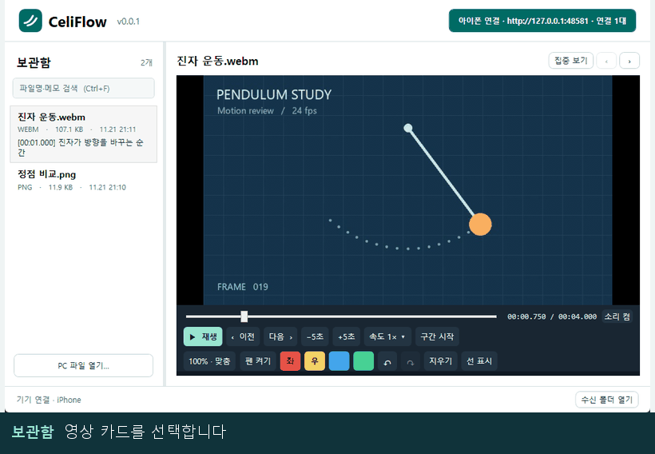
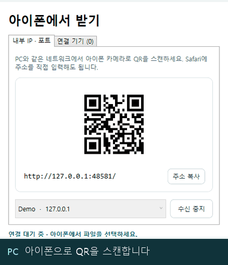
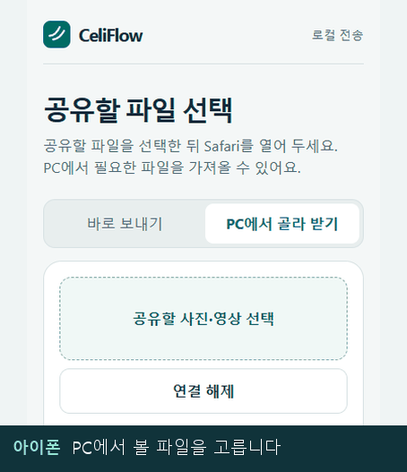
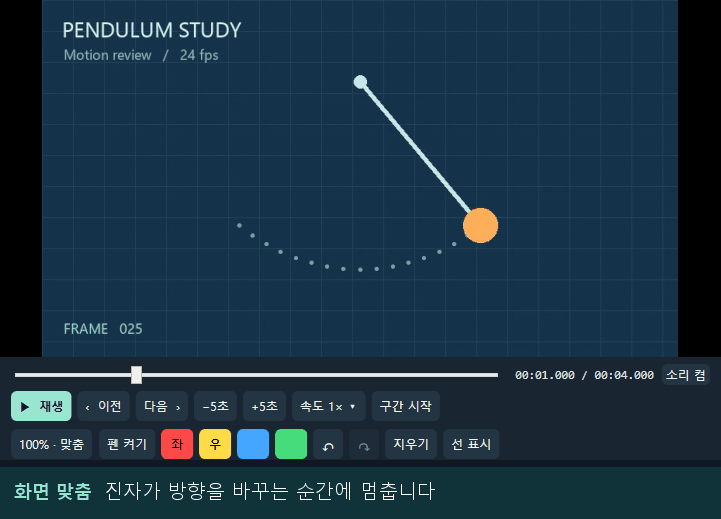

# CeliFlow Releases

CeliFlow는 영상을 한 프레임씩 살펴보고 화면에 선을 그리거나 원하는 장면에 메모를 남길 수 있는 Windows 플레이어입니다. 같은 Wi-Fi에서 아이폰의 사진과 영상을 PC로 전송할 수 있습니다.

## Windows 다운로드

**[최신 Windows x64 버전 다운로드](https://github.com/Kor-Fresh/CeliFlow-Releases/releases/latest)** · 릴리스의 **Assets**에서 이름이 `-win-x64.zip`으로 끝나는 파일을 받으세요.

1. ZIP을 새 폴더에 모두 풀고 `CeliFlow.exe`를 실행합니다.
2. 탐색기에서 영상을 왼쪽 보관함으로 끌어 놓습니다. 아이폰에서 보내려면 PC의 **아이폰 연결**을 열고 같은 Wi-Fi에 연결한 아이폰으로 QR을 스캔합니다.
3. 영상을 선택한 뒤 **Space**로 재생하거나 멈추고, **←** · **→**로 한 프레임씩 이동합니다.

실행에 필요한 .NET 런타임과 재생 엔진이 포함되어 있습니다. 구성 요소의 라이선스와 재생 엔진 빌드 정보는 ZIP의 `licenses/` 폴더에 있습니다.

## 주요 기능 미리보기

### 한 프레임씩 살펴보고 구간 반복하기

보관함에서 영상을 열고 **← / →**로 진자의 움직임을 한 프레임씩 따라가 보세요. 반복해서 보고 싶은 장면의 시작과 끝에서 **L**을 한 번씩 누르면 그 사이만 재생됩니다.

### 아이폰 사진과 영상을 PC로 가져오기

| 아이폰에서 바로 보내기 | PC에서 골라 가져오기 |
| --- | --- |
|  |  |
| 아이폰에서 파일을 고르고 PC에서 **수신 승인**을 누릅니다. | 아이폰에서 공유할 파일을 고르면 PC의 **연결 기기** 탭에서 필요한 항목만 가져올 수 있습니다. |

### 확대해서 표시하고 원본과 비교하기

확인할 위치에 커서를 두고 **마우스 휠**로 확대하세요. **P**로 펜을 켜서 표시하고 **H**를 누르면 같은 프레임에서 표시를 숨기거나 다시 볼 수 있습니다.

### 장면에 메모를 남기고 다시 찾기

보관함 카드의 **메모 작성·수정… → 시각 넣기**로 현재 프레임을 기록하세요. 나중에 메모 속 단어로 카드를 검색하고 **메모 시점으로 이동**에서 해당 장면을 다시 열 수 있습니다.

